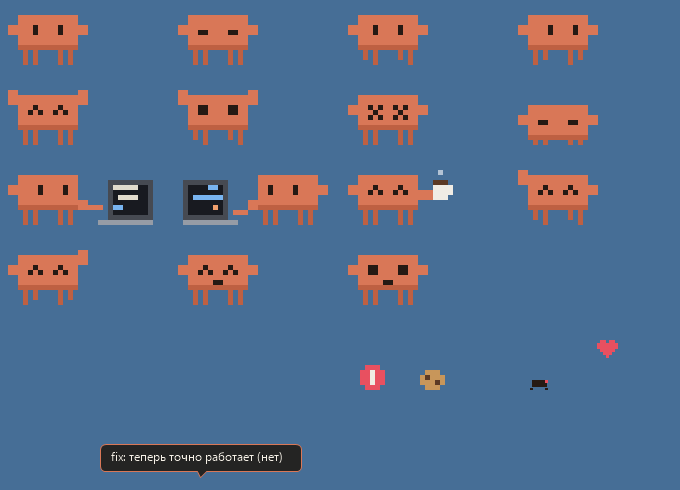
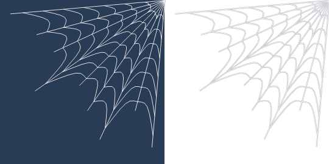

# Claude Buddy

Маленький пиксельный Клод, который живёт на рабочем столе Windows: кодит, пьёт кофе, ловит баги, ползает по краям экрана, спускается на паутинке и плетёт паутину, пока вас нет за компьютером.

*A tiny pixel-art desktop pet for Windows. The interface is in Russian. One C# file, no dependencies: it builds with the compiler that ships with Windows.*

> Неофициальный фан-проект. Не связан с Anthropic и не поддерживается ею. Claude — товарный знак Anthropic.



## Установка

Нужна Windows 10 или 11. Ничего скачивать не надо: компилятор C# уже есть в .NET Framework 4, который входит в Windows.

```powershell
git clone https://github.com/sadkl-04/mini-claude-desktop.git
cd mini-claude-desktop
powershell -ExecutionPolicy Bypass -File install.ps1
```

Скрипт собирает `ClaudeBuddy.exe`, копирует его в `%USERPROFILE%\ClaudeBuddy`, добавляет в автозапуск и запускает. Автозапуск можно выключить в меню: пункт «Запускать вместе с Windows».

| Параметр | Что делает |
| --- | --- |
| `-BuildOnly` | только собирает exe рядом с исходником, ничего не устанавливает |
| `-NoLaunch` | устанавливает, но не запускает |

**Удаление:** выключите автозапуск в меню, выберите «Выход» и удалите папку `%USERPROFILE%\ClaudeBuddy`. Если подключали уведомления, уберите ещё и хук из настроек Claude Code.

## Что он умеет

### Мышью

| Действие | Что будет |
| --- | --- |
| Клик | отзовётся и подпрыгнет. Если тыкать слишком часто, обидится |
| Поводить курсором по нему | мурчит и пускает сердечки |
| Перетащить и бросить | летит с физикой, от сильного удара кружится голова |
| Потрясти в воздухе | возмутится, а после приземления будет с головокружением |
| Бросить на папку рабочего стола | встанет на неё |
| Клик по багу или мячику | раздавит баг, пнёт мячик |
| Перетащить на него файл | «попробует» его и пошутит. Смотрит только на имя и размер, файл не открывает и не меняет |
| Правый клик | меню |
| Левый клик по значку в трее | спрятать или показать |

### Меню «Поиграть»

- **Кинуть мячик:** гоняет мячик, пока не сделает 7 ударов.
- **Догонялки с курсором:** бегает за курсором и прыгает, побеждает после трёх касаний.
- **Потанцевать.**
- **Запустить баг:** охотится на баг.
- **Залезть на папку:** запрыгивает на папку рабочего стола, если её не закрывают окна.
- **Ползать по краям экрана:** проходит круг по полу, стене, потолку и другой стене.
- **Спуститься на паутинке:** спускается с потолка вниз головой. Курсор его останавливает и раскачивает, а если потянуть, паутинка порвётся.
- **Сесть на окно:** садится на верхний край окна и катается, когда окно двигают.
- **Прятки:** выглядывает из-за края экрана, поймать можно кликом.
- **Сплести паутину / Убрать паутину.**

В основном меню ещё есть «Налить кофе», «Покормить печенькой», «Попросить писать код» и «Что ты умеешь?».

### Сам по себе

- **Паутина, пока вас нет.** После 5 минут без мыши и клавиатуры забирается в верхний угол и плетёт паутину. Полная занимает 10 минут. Когда вы вернётесь, он похвастается, а паутина через 2 минуты исчезнет. Клики проходят сквозь неё.

  

- **Танцы под музыку.** Если звук держится около 3 секунд, танцует в такт. Он слышит только громкость, поэтому видео и звонки тоже считаются музыкой.
- **Работа вместе с Claude Code.** Пока Claude Code работает, садится за ноутбук.
- **Прогулки.** Сам ползает по экрану, встаёт на папки и окна, спускается на паутинке.
- **Приветствие по времени суток.** Ночью может напомнить, что пора спать.

Он прячется, когда открыто полноэкранное приложение.

## Настройки в меню

| Пункт | Что делает | По умолчанию |
| --- | --- | --- |
| Тихий режим | спит на месте и не разговаривает | выкл. |
| Работает, когда работает Claude Code | садится за ноутбук, когда Claude Code активен | вкл. |
| Танцует под музыку | реакция на звук | вкл. |
| Сам лазает по экрану | сам забирается на папки, окна и края экрана | вкл. |
| Уведомлять о готовых задачах Claude | см. ниже | вкл. |
| Плетёт паутину, пока меня нет | если выключить, просто заснёт | вкл. |
| Поверх окон | держится над другими окнами | вкл. |
| Размер | маленький, средний, большой | средний |

Настройки лежат в `settings.ini` рядом с exe.

## Уведомления о готовых задачах Claude Code

Когда Claude Code заканчивает ответ, приходит уведомление Windows, а Клод радуется. Само по себе это не включится: нужно добавить хук в `~/.claude/settings.json`, заменив `ИМЯ` на имя вашего пользователя Windows. Если в файле уже есть другие настройки, допишите к ним раздел `hooks`.

```json
{
  "hooks": {
    "Stop": [
      {
        "hooks": [
          {
            "type": "command",
            "command": "\"C:/Users/ИМЯ/ClaudeBuddy/ClaudeBuddy.exe\" --notify 2>/dev/null || true",
            "timeout": 5
          }
        ]
      }
    ]
  }
}
```

Уведомление приходит после каждого ответа Claude, в том числе короткого. Открытые сессии могут подхватить хук только после перезапуска. В режиме «Не беспокоить» Windows может скрывать уведомления.

## Что программа читает на компьютере

Всё остаётся на компьютере, по сети программа ничего не отправляет.

| Что | Зачем |
| --- | --- |
| Время изменения файлов в `~/.claude/projects` (содержимое не читается) | понять, что Claude Code работает |
| Папка проекта из данных хука `Stop` | показать её название в уведомлении |
| Уровень громкости устройства вывода (звук не записывается) | танцы под музыку |
| Положение и названия значков рабочего стола, положение верхнего окна | вставать на папки и окна |
| Положение курсора, время последнего ввода (нажатия клавиш не читаются) | реагировать на мышь, замечать, что вас нет |
| Имя и размер файла, брошенного на него | шутка про файл |

## Для разработчиков

Весь код лежит в одном файле, [Buddy.cs](Buddy.cs). Он написан на C# 5, чтобы собираться встроенным `csc.exe`.

Основные части:

| Класс | Зачем |
| --- | --- |
| `BuddyForm` | окно питомца: состояния (`St`), физика, ввод, отрисовка |
| `Painter` | пиксельная графика на сетке 16×11 |
| `Web`, `WebForm` | паутина и её отдельное окно |
| `AudioMeter` | уровень звука через Core Audio |
| `Desktop` | папки рабочего стола и верхнее окно через UI Automation |
| `TaskNotice` | обработка `--notify` из хука |
| `Settings`, `Autostart` | настройки и задача автозапуска |

`ClaudeBuddy.exe --sheet путь.png` рисует все позы на одном листе, как [docs/poses.png](docs/poses.png).

### Тесты

[tests/BuddyTest.cs](tests/BuddyTest.cs) прогоняет поведение с поддельным курсором, не показывая окно питомца. Запускать из корня репозитория:

```powershell
$fw = "$env:WINDIR\Microsoft.NET\Framework64\v4.0.30319"
& "$fw\csc.exe" /nologo /target:winexe /codepage:65001 /main:BuddyTest /out:BuddyTest.exe "/lib:$fw\WPF" /r:System.Drawing.dll /r:System.Windows.Forms.dll /r:WindowsBase.dll /r:UIAutomationClient.dll /r:UIAutomationTypes.dll Buddy.cs tests\BuddyTest.cs
Start-Process .\BuddyTest.exe -ArgumentList "$PWD\test-out" -Wait
Get-Content .\test-out\result.txt
```

Результаты и кадры появятся в `test-out`. Во время теста на несколько секунд проигрывается очень тихий тон: так проверяется чтение уровня звука. Настоящее перетаскивание файлов из Проводника тесты не проверяют.

## Лицензия

Лицензия пока не выбрана, поэтому по умолчанию все права сохраняются за автором.
